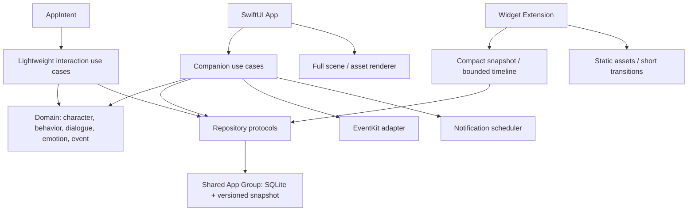

# Мой Компаньон — единая мастер-спецификация для Codex

**Версия:** 2.0 · 26.11.2026  
**Статус:** продуктовая и техническая спецификация, не отчёт о готовой реализации.  
**Целевая платформа:** iPhone, нативное iOS-приложение + интерактивные виджеты.  
**Минимальная версия ОС:** iOS 17.0.  
**Язык продукта:** русский.  
**Главный приоритет:** безопасное, практически незаметное для системы дополнение к iOS.

> Это единый актуальный источник требований. Он заменяет предыдущие версии ТЗ и дополнение System Performance Non-Interference Policy. При конфликте с ранними идеями, макетами или старым кодом использовать эту спецификацию. Кенто Нанами и Маки Дзэнин исключены из стартового состава. Не возвращать их в интерфейс, пакеты, тестовые данные и уведомления.
>
> В конце документа находятся встроенные изображения из ранее разработанных концептов. Не подменять их упрощённым интерактивным прототипом из чата. Они являются визуальным направлением проекта, а не готовыми production-ресурсами или точными скриншотами iOS. Их можно извлечь локальным скриптом из раздела 35. Не выводить Base64 в контекст модели или журналы.

## 0. Инструкция по работе с этим файлом

Положи файл в корень репозитория. Перед началом прочитай основной текст **до строки `<!-- END_SPEC -->`**. Если используешь терминал, можно получить текст без встроенных изображений командой:

```bash
sed '/^<!-- END_SPEC -->$/,$d' My_Companion_Codex_Master_Spec.md
```

Извлеки приложенные визуальные референсы по инструкции в разделе 35 в `Documentation/DesignReferences/`, просмотри их как изображения и зафиксируй дизайн-решения. Бинарный хвост документа не нужно отправлять в модель как текст. Не добавляй этот хвост в AGENTS.md. Если название файла изменено, используй его фактический путь.

Задача — не просто изложить план, а начать реализацию в текущем репозитории: провести аудит, создать архитектурный фундамент, получить вертикальный прототип приложения и виджета, проверить доступные сборки и тесты. Продолжать по этапам до рабочего MVP в пределах предоставленной среды. Не выдумывать результаты сборок, тестов, запусков и просмотра изображений.

## 1. Роль исполнителя и приоритеты

Действуй как senior iOS developer, software architect, UI/UX designer, narrative designer, QA automation engineer, security engineer и performance engineer. Реализуй сопровождаемый продукт, а не одноразовый демо-проект.

Приоритеты в строгом порядке:

1. Безопасность устройства и сохранность пользовательских данных.
2. Отсутствие существенного негативного влияния на iOS и сторонние приложения.
3. Стабильность, энергоэффективность, совместимость.
4. Корректность уведомлений, календаря, напоминаний и виджетов.
5. Индивидуальность персонажей, выразительность и соответствие визуальным референсам.
6. Дополнительные анимации, пасхалки и коллекции.

Ни один эффект не оправдывает системный лаг, перегрев, утечку памяти или обход ограничений iOS. При конфликте требований упростить эффект, а не систему. Вместе с тем не заменять утверждённую художественную концепцию безликими карточками, эмодзи, случайными аватарами или техническим интерфейсом только ради быстроты реализации.

## 2. Продуктовая концепция и объём MVP

«Мой Компаньон» — личный аниме-компаньон на главном экране iPhone, который создаёт ощущение собственной жизни. Это приложение с выбором персонажей и интерактивным WidgetKit-виджетом, а не чат-бот, игра с обязательными ежедневными действиями или системный оверлей.

Персонаж сам меняет позы и эмоции, иногда произносит фразы, хвалит, шутит, подбадривает, ворчит, драматично обижается, грустит, радуется, спит, тренируется или совершает характерное действие. Он реагирует на зарегистрированные взаимодействия, время суток, выполненные задачи, календарные события и редкие пасхалки. У каждого персонажа собственные стиль, речь и логика реакций.

### 2.1. Обязательный функционал

- Шесть стартовых персонажей, свободный выбор и переключение.
- Чиби-форма и альтернативная портретная форма.
- Главный экран приложения с живой сценой, галерея персонажей, календарь, напоминания, настройки.
- Home Screen Widgets: small, medium, large.
- Поддерживаемые accessory-виджеты экрана блокировки.
- Интерактивное нажатие на персонажа через AppIntents, смена реплики/позы; серия фактически обработанных нажатий может открыть пасхалку.
- Короткие анимации смены состояния в рамках WidgetKit, полноценные сценки только внутри приложения.
- Случайные русскоязычные реплики и комплименты в речевом облаке, а НЕ отдельная кнопка «Комплименты».
- Локальные уведомления, собственные напоминания, интеграция с системным календарём по разрешению.
- Утренние и ночные реакции, тихие часы, настройка интенсивности общения.
- Характерные пасхалки, виртуальные находки и иллюстрации, открываемые по действию пользователя.
- Локальное хранение, работа без интернета, без обязательной регистрации.
- Режимы Normal / Eco / Safe, приостановка компаньона, диагностика.
- Русский интерфейс и русские реплики, поддержка accessibility.
- Автоматические тесты, матрица симуляторов и реальные замеры на физических iPhone.

### 2.2. Не входит в MVP

- Jailbreak, плавающий персонаж над другими приложениями, модификация SpringBoard, Picture-in-Picture в качестве обхода ограничений.
- Непрерывная фоновая анимация, произвольные оверлеи, отслеживание разблокировок или скрытое наблюдение за приложениями.
- Сервер, APNs, встроенный LLM, реклама, подписки, облачная синхронизация.
- Автоматическая смена системных обоев, открытие приложений или файлов без действия пользователя.
- Импорт произвольных пользовательских ZIP-пакетов до завершения отдельного аудита безопасности.
- Live Activities / Dynamic Island — дополнительный режим только после MVP, если найдётся обоснованное ограниченное по времени действие, соответствующее назначению ActivityKit. Не использовать как бесконечный способ удерживать персонажа на экране.

## 3. Платформенные возможности: что реально поддерживается

| Возможность | Решение |
|---|---|
| Питомец на домашнем экране | WidgetKit, системные семейства |
| Персонаж на экране блокировки | accessoryCircular / accessoryRectangular / accessoryInline; адаптация к ограничениям системы |
| Реакция без запуска приложения | SwiftUI Button/Toggle с AppIntent, где доступно |
| Случайная фраза и смена позы | Timeline, подготовленные состояния, обновление по взаимодействию |
| Короткие анимации | Поддерживаемые transitions/contentTransition, максимум 2 секунды |
| Сложный многостадийный портал | Экспериментальная анимация перехода; при невозможности — начальный/финальный кадры; полноценная сцена внутри приложения |
| Уведомления | UserNotifications, локальное планирование; доставка зависит от разрешений и iOS |
| Календарь/напоминания | EventKit с явным разрешением и минимальными данными; собственная локальная модель задач |
| Иллюстрация/подарок | Локальная коллекция, notification attachment при поддержке, открытие по действию пользователя |
| Точное время смены картинки виджета | Не гарантируется; iOS контролирует обновления |
| Определение пробуждения/разблокировки | Не поддерживается публичным API для данной задачи; использовать только зарегистрированный контакт с нашим продуктом или расписание |
| Напоминание о перерыве (согласовано 28.11.2026) | По добровольному разрешению Screen Time пользователь выбирает одно приложение и дневной порог. DeviceActivity сообщает о накопленном времени за день. Компаньон может показать одно локальное напоминание. Выключение прекращает мониторинг. Названия и история использования не передаются. |
| Непрерывное исполнение в фоне | Не реализуется |
| Автоматическое добавление виджета на экран | Не обещать; пользователь добавляет через интерфейс iOS |

Apple документирует динамический бюджет обновлений WidgetKit: часто просматриваемый виджет обычно получает 40–70 обновлений в сутки, интервалы могут существенно различаться; рекомендуемый интервал между будущими timeline entries — не меньше примерно 5 минут. Это описание поведения платформы, а не гарантии. Наш пассивный ориентир существенно консервативнее: 30–60 минут. См. официальные источники в разделе 34.

## 4. Абсолютные ограничения безопасности

Использовать только документированные публичные Apple API и официальные механизмы песочницы. Запрещено:

- jailbreak, private API, эксплойты, доступ к SpringBoard, вмешательство в системные файлы и настройки безопасности;
- обход sandbox, неофициальные entitlements, подделка системного интерфейса/уведомлений;
- искусственный keep-alive через звук, геолокацию, VoIP, аудио/видео или другие фоновые режимы;
- бесконечные циклы, постоянный опрос, частые принудительные refresh, периодический фоновый рендер;
- скрытое отслеживание разблокировок, чужих приложений, активности телефона;
- загрузка исполняемого кода, выполнение скриптов из контентных пакетов, непроверенные зависимости;
- отправка личных данных на сервер, лишние разрешения, рекламные и аналитические SDK;
- разрушительные миграции, очистка системного календаря, произвольное удаление пользовательских файлов;
- использование приватной системной диагностики, недокументированных команд на личном устройстве;
- публикация, установка на физический телефон, изменение signing или внешняя передача проекта без соответствующего разрешения владельца.

Никакая спецификация не может гарантировать абсолютное отсутствие ошибок или нулевое потребление ресурсов. Официальные API снижают риск, а подтверждение невмешательства достигается измерениями и release gate, описанными ниже.

## 5. Технологический стек

| Компонент | Технология |
|---|---|
| Язык | Swift, поддерживаемая версия Swift в установленном Xcode |
| UI | SwiftUI, MVVM и однонаправленный поток данных |
| Домашний экран / Lock Screen | WidgetKit |
| Интерактивность и конфигурация | AppIntents / AppIntentConfiguration |
| Календарь | EventKit, при необходимости EventKitUI |
| Напоминания | Локальная модель; опциональный EventKit adapter |
| Уведомления | UserNotifications |
| Общее хранилище | App Groups + SQLite (sqlite3), компактные снапшоты |
| Анимации приложения | SwiftUI; SpriteKit только при обоснованной необходимости |
| Анимации виджета | Лёгкие поддерживаемые SwiftUI transitions |
| Изображения | Asset Catalog, оптимизированные PNG/HEIF/JPEG по необходимости, ImageIO |
| Контент персонажей | Версионированный JSON + локальные изображения |
| Асинхронность | Swift Concurrency, ограниченные задачи |
| Логирование и замеры | OSLog, signposts, XCTest metrics, Instruments, при наличии MetricKit |
| Тесты | XCTest / XCUITest, симуляторы, физические устройства |
| Локализация | String Catalog (.xcstrings), ru; допустима структура для будущих языков |
| Управление версиями | Git, ADR, документация, проверяемый проект Xcode |

Использовать актуальный стабильный Xcode и SDK, доступные в среде. Deployment target 17.0, новые API за `#available` и с fallback. Не привязывать проект к придуманной версии Xcode или ещё не установленному runtime. Не использовать Unity, Unreal, Flutter, React Native. Не добавлять внешние зависимости, пока не доказана необходимость; согласовать новые SDK. Не включать background capabilities, которые MVP не использует.

## 6. Архитектура: границы ответственности

Clean Architecture в прагматичной форме. Бизнес-логика не зависит от SwiftUI, WidgetKit, EventKit или глобальных singleton. Domain и use cases тестируются независимо. Инфраструктура реализует протоколы. Внедрение зависимостей через composition root приложения и отдельный composition root widget/intent. Не использовать один универсальный God Manager.



Ключевой принцип: приложение подготавливает данные при доступном выполнении; виджет не является игровым движком. Он получает компактный snapshot, необходимые небольшие ресурсы и лёгкий детерминированный расчёт будущих состояний. Если приложение давно не запускалось, виджет остаётся работоспособным благодаря ограниченной чистой логике timeline и локальным ресурсам. Intent выполняет небольшую транзакцию, формирует результат и возвращает управление системе. Не подключать тяжёлый renderer, полный календарный адаптер или весь UI к Widget Extension.

### 6.1. Структура репозитория

```text
MyCompanion/
├── MyCompanion.xcodeproj/          # либо workspace, если это обосновано
├── App/
│   ├── MyCompanionApp.swift
│   ├── AppCoordinator.swift
│   ├── AppContainer.swift
│   └── AppLifecycle.swift
├── Packages/
│   └── CompanionCore/
│       ├── Package.swift
│       ├── Sources/
│       │   ├── CompanionDomain/    # типы, правила, протоколы
│       │   ├── CompanionEngine/    # pure logic: dialogue, emotion, event, behavior
│       │   ├── CompanionUseCases/  # команды, orchestration, light timeline
│       │   └── CompanionStorage/   # SQLite и snapshot adapter
│       └── Tests/
├── Features/
│   ├── Onboarding/
│   ├── Home/
│   ├── CharacterSelection/
│   ├── CharacterDetails/
│   ├── Calendar/
│   ├── Reminders/
│   ├── Settings/
│   ├── Gallery/
│   ├── WidgetConfiguration/
│   └── Diagnostics/
├── Infrastructure/
│   ├── EventKit/
│   ├── Notifications/
│   ├── AppGroups/
│   ├── Storage/
│   ├── Logging/
│   └── Performance/
├── SharedIntents/                 # только extension-safe use cases
├── WidgetExtension/
│   ├── CompanionWidgetBundle.swift
│   ├── CompanionWidget.swift
│   ├── CompanionTimelineProvider.swift
│   ├── CompanionTimelineEntry.swift
│   ├── WidgetConfigurationIntent.swift
│   └── Views/
│       ├── SmallWidgetView.swift
│       ├── MediumWidgetView.swift
│       ├── LargeWidgetView.swift
│       └── LockScreenWidgetView.swift
├── Resources/
│   ├── Characters/                # development / release variants
│   ├── Assets.xcassets/
│   └── Localizable.xcstrings
├── Tests/
│   ├── UnitTests/
│   ├── IntegrationTests/
│   ├── UITests/
│   └── PerformanceTests/
├── Scripts/
├── Documentation/
│   ├── DesignReferences/          # НЕ runtime resources
│   └── ADR/
├── AGENTS.md
├── README.md
├── CHANGELOG.md
└── TEST_REPORT.md
```

Допустимо адаптировать структуру под существующий репозиторий. Не переписывать работающий проект без причины. Не создавать пустой модуль на каждый термин: группировать логические подсистемы, если так проще тестировать. Связи targets должны исключать UIKit-приложение и extension-unsafe код из Widget Extension. Проверить `APPLICATION_EXTENSION_API_ONLY` для применимых targets. Shared intents должны компилироваться в нужных targets согласно выбранной схеме исполнения; не предполагать, что intent всегда запускает основной процесс.

### 6.2. Логические подсистемы

| Модуль | Назначение |
|---|---|
| CharacterEngine | Registry, загрузка, проверка пакетов, активный герой, формы, темы |
| DialogueEngine | Выбор реплики, фильтры контекста, антиповтор, шаблоны, веса, fallback |
| EmotionEngine | Индивидуальные эмоции, изменение и возврат к норме |
| BehaviorEngine | FSM, условия, приоритеты, cooldown, уникальные действия |
| EventEngine | Нормализует триггеры, устраняет дубли, координирует реакции |
| AnimationEngine | Визуальное состояние и animation descriptor; два независимых renderer |
| TimelineEngine | Ограниченное детерминированное планирование состояний виджета |
| CalendarEngine | Минимальный snapshot EventKit, stale status, разрешения |
| ReminderEngine | CRUD, повторение, выполнение и перенос локальных задач |
| NotificationEngine | Планирование, reconciliation, дедупликация, тихие часы |
| SafetyManager | Normal/Eco/Safe, feature flags, ограничения, fallback, остановка |
| Persistence/Validation | Транзакции, миграции, schema checks, целостность ресурсов |

Интерфейсы предусмотреть для `Clock`, `RandomSource`, `CharacterRepository`, `StateRepository`, `SnapshotRepository`, `CalendarService`, `ReminderRepository`, `NotificationScheduling`, `WidgetRefreshRequesting`, `AssetProvider`, `DiagnosticsSink`. Тесты используют fake clock и seeded RNG. Не генерировать состояние в SwiftUI `body`.

## 7. Стартовые персонажи: только шесть

| Стабильный ID | Русское имя | Произведение | Характер |
|---|---|---|---|
| satoru_gojo | Сатору Годжо | Магическая битва | Харизматичный, игривый |
| toji_fushiguro | Тоджи Фушигуро | Магическая битва | Прямой, суровый, независимый |
| jinshi | Женьши | Монолог фармацевта | Изысканный, обаятельный, театральный |
| sung_jinwoo | Сон Джин Ву | Поднятие уровня в одиночку | Сдержанный, целеустремлённый |
| ryomen_sukuna | Рёмен Сукуна | Магическая битва | Высокомерный, язвительный |
| maomao | Мао Мао | Монолог фармацевта | Наблюдательная, любопытная, ироничная |

Нанами и Маки исключены. Если в существующем прототипе остались их ID, не оставлять в стартовом registry. Не удалять реальные пользовательские сохранения без согласования; при необходимости мигрировать выбор на доступного персонажа с безопасным уведомлением.

На каждого: собственное описание, personality, речь, цветовая тема, чиби и портрет, минимум 15 визуальных состояний (с возможностью повторного использования базового ресурса только при явной маркировке fallback), индивидуальные действия, минимум 5 уникальных пасхалок, 100–200 реплик, целевой объём 150.

Итого: 6 персонажей, 600 реплик — жёсткий минимум, 900 — целевой объём, 1200 — расширенный; минимум 30 пасхалок, 12 форм, около 90 описанных визуальных состояний. Это критерии разработки, не уже существующий контент.

До написания контента изучить официальные описания, законно доступные материалы и характеры. Задокументировать ссылки и выводы в `Documentation/CharacterReferences.md`. Не выдавать адаптацию за точную цитату и не сочинять канонические факты. Разрешённые визуальные источники и права проверяются отдельно. Не использовать фан-вики как единственный источник канона. Не копировать массово реплики из манги, аниме, субтитров или фанатских переводов.

### 7.1. Сатору Годжо

**Характер:** харизматичный, самоуверенный, игривый, любит поддразнивать; способен резко становиться серьёзным. Лёгкая театральная обида без давления. Поддерживает через юмор и преувеличенное самодовольство.

**Внешность/стиль:** белые взъерошенные волосы, чёрная повязка или тёмные очки, тёмный высокий воротник; холодный голубой, белый, глубокий индиго, сиреневые акценты. Чиби улыбается, опираясь щекой на ладонь. Ночной фон с мягкими синими бликами, цветами/городом. См. R01, R02.

**Действия:** поправляет повязку, снимает очки, подмигивает, ест сладости, демонстрирует декоративную «бесконечность», исчезает и появляется в другой части сцены, зевает, театрально отворачивается.

**Пасхалки:** сладость; редкий взгляд без повязки; шуточное «соревнование» после завершения задачи; необычная голубая вспышка; редкая серьёзная поддержка.

**Примеры оригинальных реплик:** «Неплохо. Почти на моём уровне». «Даже сильнейшим нужен отдых». «Через {minutesRemaining} мин. встреча. Не опаздывай, чемпион!» «Эй, хватит тыкать. Я и так великолепен». «Сегодня у тебя явно получилось». Все примеры адаптировать под реальный контекст, а не механически копировать шаблоны.

### 7.2. Тоджи Фушигуро

**Характер:** грубоватый, лениво-самоуверенный, немногословный, независимый; прямое замечание вместо длинной морали. Редкая похвала звучит весомо. Забота — игровая адаптация, не заявление о каноне.

**Внешность/стиль:** тёмные волосы, атлетичный силуэт, узнаваемая отметина у рта, чёрная облегающая одежда. Графит, тёмно-зелёный, приглушённый серый, мягкий зелёный контур. Ночная сцена с листвой и тёплыми окнами. См. R03 — именно исправленный вариант, где вместо «Комплименты» кнопка «Персонажи».

**Действия:** разминается, отжимается, складывает руки, лежит, зевает, ворчит, отворачивается, демонстрирует короткое стилизованное движение. Не добавлять графическое насилие.

**Пасхалки:** редкая похвала после серии задач; тренировочная сценка; ленивый сон; неожиданная находка; сдержанная улыбка после взаимодействия.

**Примеры:** «Нормально. Продолжай». «Хватит откладывать». «Спать иди. Завтра дел полно». «До встречи {minutesRemaining} мин. Не тормози». «Чего тебе?». «Ладно. Сегодня заслужил похвалу».

### 7.3. Женьши

**Характер:** изящный, обаятельный, лукавый, внимательный, эмоционально выразительный. Допускается лёгкая драматичность и обида без вины или принуждения. Речевой профиль по умолчанию — вежливое «вы»; настройка обращения общая для всех персонажей, если подходит речи.

**Внешность/стиль:** длинные тёмно-фиолетовые волосы, украшения, благородное одеяние, сливовый, тёплое золото, кремовый, индиго. Дворцовый интерьер, фонари, лепестки. См. R04.

**Действия:** пьёт чай, читает свиток, поправляет волосы, раскрывает веер, смущается, мягко отворачивается, дарит цветок, появляется среди лепестков.

**Пасхалки:** цветок; редкое приглашение на чай; записка; лепестки; неожиданная смущённая эмоция.

**Примеры:** «Ваше упорство весьма впечатляет». «Полагаю, сегодня вам полагается немного отдыха». «Позвольте напомнить о встрече». «Неужели вы собираетесь работать до рассвета?» «Я приготовил для вас кое-что интересное».

### 7.4. Сон Джин Ву

**Характер:** спокойный, дисциплинированный, решительный, немногословный, ориентирован на рост и действия. Поддержка через признание усилий, не бесконечные лозунги.

**Внешность/стиль:** тёмные взъерошенные волосы, чёрный высокий воротник, фиолетово-синяя теневая энергия, силуэты теневой армии и руин. Ночной индиго, электрический фиолетовый, глубокий чёрный. См. R05–R09; английский текст старых макетов обязательно заменить русским, кнопку «Compliment» удалить.

**Действия:** теневой портал, переход из одной стороны виджета в другую, призыв декоративной тени, эффект повышения уровня, отдых, тренировка, исследование условного подземелья, находка предмета.

**Пасхалки:** теневой портал; миниатюрный союзник; карточка найденного предмета; декоративное повышение уровня; редкая уверенная улыбка. Никаких обязательных ежедневных заданий с наказанием за пропуск.

**Примеры:** «Ещё один шаг вперёд». «Задание выполнено. Хорошая работа». «Отдых тоже часть подготовки». «До следующей задачи осталось {minutesRemaining} мин.». «Я вернулся».

### 7.5. Рёмен Сукуна

**Характер:** гордый, высокомерный, язвительный, самоуверенный, склонен к насмешкам. Редкое одобрение вместо слащавой поддержки. Для пользователя доступен мягкий/обычный/резкий (но безопасный) уровень сарказма. Не романтизировать угрозы, принуждение, унижение, жестокость; запрещены реальные угрозы, травля и опасные рекомендации.

**Внешность/стиль:** отдельный референс в предыдущих итерациях не был разработан; использовать общую утверждённую композицию R01, характерные визуальные мотивы — после проверки источников и прав. Предлагаемая палитра: бордовый, красный, чёрный, тёмно-малиновый, приглушённый янтарный. Чиби, альтернативный портрет, стилизованная красная аура. Не выдавать эту новую палитру за уже утверждённый визуальный лист.

**Действия:** сидит на условном троне, усмехается, закатывает глаза, отворачивается, демонстрирует короткий абстрактный красный эффект или пространственный разрез без насилия, редко одобрительно улыбается.

**Пасхалки:** трон; редкое одобрение; красная вспышка; редкая спокойная эмоция; особый взгляд после завершения задачи.

**Примеры:** «Хм. Неплохо». «Удивительно. Ты действительно справился». «Не заставляй меня повторять». «Дела подождут до завтра. Отдыхай». «До встречи {minutesRemaining} мин. Не опаздывай». Не употреблять грубость как наказание.

### 7.6. Мао Мао

**Характер:** наблюдательная, аналитическая, любопытная, слегка отстранённая, практичная, ироничная; увлечена исследованиями. Не превращать в универсального сладкого помощника.

**Внешность/стиль:** тёмные зеленовато-синие волосы, узнаваемая причёска и зелёно-кремовое традиционное одеяние; нефритовый, кремовый, оливковый, тёплый коричневый, мягкое золото. Лаборатория/аптекарская, травы, ступка, фонари, карточки находок, лепестки. См. R10–R14. Ранние кнопки Feed/Talk/Explore заменяются общими календарём и напоминаниями; сценки сохраняются как поведение.

**Действия:** изучает растение, перебирает травы, работает со ступкой, читает, записывает наблюдения, рассматривает находку, воодушевляется, приносит коллекционную иллюстрацию, засыпает за столом. Декоративные эффекты/портал — условная сценка виджета, не утверждение о канонических способностях.

**Пасхалки:** карточка растения; редкая находка; сценка со ступкой; заметка в коллекцию; необычное выражение любопытства.

**Примеры:** «Любопытно. Сегодня необычное расписание». «Перерыв оказался бы полезным». «Кажется, вы снова забыли про время». «Я нашла кое-что интересное». «Ваше упорство заслуживает внимания». Не давать медицинских советов, дозировок или рецептов опасных веществ от лица персонажа.

## 8. Визуальный дизайн: обязательная опора на разработанные концепты

Главный дизайн-источник — R01, русифицированный общий концепт. Персонажные листы R02–R04, R05–R09 и R10–R14 задают композиции, эмоции, темы и сценки. Это не рисунки для прямого включения в ассеты приложения: интерфейс и персонажей нужно разделить на слои, подготовить разрешённые ресурсы, адаптировать размеры. Не извлекать графику путём обрезки целого мокапа iPhone для runtime. Встроенные копии предназначены только для design review.

**Запрещённое визуальное направление:** упрощённый чат-прототип с маленьким квадратным аватаром, белым прямоугольным текстовым блоком, календарной строкой и кнопками симуляции. Он не является референсом для production. Диагностические кнопки допустимы только в Debug/Diagnostics и не должны попадать в пользовательский UI.

### 8.1. Design system

- Premium anime companion: выразительная сцена, а не generic dashboard; глубокий фон, мягкий свет, тонкие рамки, лёгкое стекло/полупрозрачность, скругления, атмосферная иллюстрация.
- Чиби — главный элемент; в среднем и большом формате персонаж занимает примерно половину или более визуальной сцены, если сохраняются читаемость и доступность. Портрет — выбираемый альтернативный режим.
- Речевое облако связано с персонажем визуально; текст короткий, естественный, контрастный. Комплимент появляется сам, не существует как кнопка.
- Фон и эффекты принадлежат виджету; системные иконки и wallpaper на мокапах иллюстративны. Не пытаться воспроизвести или менять системный Home Screen.
- Панель действий минимальна: «Календарь», «Напоминания», при достаточном размере «Персонажи» или настройки. На малом виджете вместо панели — персонаж и одна короткая реплика/значимый индикатор.
- Настроение и энергия — опциональные компактные индикаторы, не важнее персонажа. Энергия — виртуальная, не заряд телефона. Не перегружать метриками и не принуждать к уходу.
- Темы общие по структуре, индивидуальные по палитре и мотивам. Не создавать шесть разрозненных UI.
- Шрифты: SF/system для читаемого UI; декоративная типографика допустима в заголовках основного приложения, только при наличии лицензии. Русский текст без обрезания, контраст в светлой/тёмной теме, accessibility.
- Статический подготовленный декор вместо непрерывных частиц, runtime blur больших слоёв и тяжёлых шейдеров.
- Respect system container backgrounds, системное тонирование, режимы отображения, margins, Lock Screen ограничения. Не обещать точные формы и размеры иллюстративных мокапов.

### 8.2. Токены темы (проектные стартовые значения, сверить с референсами)

| Персонаж | Base | Surface | Accent | Highlight | Мотив |
|---|---|---|---|---|---|
| Годжо | #10172E | #222C4C | #6BAFFF | #EEEFFF | Холодный свет, цветы, голубая энергия |
| Тоджи | #141A1A | #263533 | #85AD9B | #E1E5E0 | Листва, тени, тёплые окна |
| Женьши | #21172C | #382340 | #D1A16C | #F2DDCB | Фонари, золото, лепестки |
| Джин Ву | #0B0C16 | #1A1E3A | #7851F0 | #E6E1FF | Тени, портал, руины |
| Сукуна | #190E15 | #332027 | #D4556B | #F0D8D7 | Красная аура, трон |
| Мао Мао | #24372E | #41564A | #A5C185 | #F1E6CE | Травы, аптекарская, тёплое золото |

Точные цвета, контраст и размеры уточняются после сравнения скриншотов и тестов. Эти значения — рабочая интерпретация референсов, не извлечённые пипеткой обязательные цвета.

### 8.3. Визуальные состояния и ресурсные слои

На каждого персонажа определить минимум: neutral, talking, happy, smiling, annoyed, offended, sad, sleeping, resting, surprised, thinking, proud, specialAction1, specialAction2, rareEasterEgg. Наличие конкретных эмоциональных вариантов подтверждается ассетами или явным fallback.

Разделить ресурсы на: background (дневной/ночной при необходимости), character pose, expression или готовые комбинации поз/эмоций, foreground decor, effect overlay, speech bubble (настоящий локализованный текст), UI controls. Не рисовать текст в runtime-ассетах. Предварительно масштабировать изображения под семейства виджетов, учитывать scale. Чиби и портрет должны оставаться узнаваемыми между эмоциями и сценами.

### 8.4. Проверка качества дизайна

- До реализации всех экранов создать одну вертикальную сцепку: экран «Компаньон» + реальный medium widget на Годжо/нейтральном лицензированном прототипе, сверить композицию с R01/R02.
- Отдельно проверить светлую/тёмную тему, small/medium/large, системное тонирование, Lock Screen.
- Сделать скриншоты настоящих симуляторов и сравнить с референсами по композиции, размеру героя, читаемости, эмоциональности, палитре и расположению действий.
- Для каждого персонажа подготовить обзорный контакт-лист поз, выражений и widget previews. Не использовать прежний схематичный чат-прототип как цель.
- Если доступны только заглушки, использовать аккуратную нейтральную чиби-заглушку с тем же layout, явно обозначить `ASSETS_PENDING`, не объявлять финальный художественный этап завершённым. Не скачивать непроверенные арты.

## 9. Пакеты персонажей и контракты контента

Декларативный пакет с версионированной схемой. Ни один новый персонаж не должен требовать изменения ядра только ради загрузки, реплик, темы или стандартных действий.

```text
Characters/satoru_gojo/
├── manifest.json
├── personality.json
├── dialogue.ru.json
├── behaviors.json
├── emotions.json
├── animations.json
├── theme.json
├── rights.json
├── preview.png
├── portraits/
├── sprites/
├── backgrounds/
├── effects/
└── easter_eggs/
```

Пример (значения иллюстративны):

```json
{
  "schemaVersion": 1,
  "id": "satoru_gojo",
  "displayName": "Сатору Годжо",
  "locale": "ru",
  "version": "1.0.0",
  "defaultMood": "playful",
  "availableForms": ["chibi", "portrait"],
  "dialogueFile": "dialogue.ru.json",
  "personalityFile": "personality.json",
  "behaviorFile": "behaviors.json",
  "emotionsFile": "emotions.json",
  "animationsFile": "animations.json",
  "themeFile": "theme.json",
  "rightsFile": "rights.json",
  "minimumDialogueCount": 100,
  "targetDialogueCount": 150
}
```

`personality` описывает речевой профиль, допустимые эмоции, веса и интенсивность, тон обращений, ночную и утреннюю реакцию, ограничения. `behaviors` описывает действия и переходы. `emotions` — конфигурацию реакции и восстановления настроения. `animations` — декларативные описания переходов и ссылок на ресурсы, без кода. `theme` — цветовые токены и варианты фона. `rights` — статус разрешения ресурсов. Все связи проверяются по стабильным ID, не по локализованным строкам.

Разработка MVP начинается со встроенных пакетов. Расширяемость для будущего ZIP-импорта проектировать без публичной кнопки импорта до готовности валидатора. Не исполнять код из пакета. Не использовать путь из JSON как абсолютный URL/путь к произвольному файлу. Все ссылки относительные, ограниченные root пакета и проверенные.

## 10. Dialogue Engine: реплики

Создать полноценные текстовые наборы, а не только 5–10 примеров или незаполненные шаблоны. Для каждого героя: целевые 150 уникальных реплик, допустимый диапазон 100–200; 100 — минимум, а не предпочтительный результат. Общая цель 900 реплик для шести героев.

### 10.1. Распределение на персонажа

| Категория | Цель |
|---|---:|
| Утренние приветствия, раннее взаимодействие | 10 |
| Дневные и вечерние реплики | 10 |
| Спонтанные комплименты и добрые фразы | 20 |
| Поддержка, мотивация, успех | 15 |
| Реакции на фактические нажатия, включая повторные | 20 |
| Календарные события | 20 |
| Напоминания, выполнение, перенос | 20 |
| Ночные реакции, сонливость, ворчание, забота | 15 |
| Длительное отсутствие взаимодействия | 8 |
| Редкие фразы и пасхалки | 12 |
| **Итого** | **150** |

Внутри категорий покрыть нейтральные, весёлые, серьёзные, гордые, задумчивые, сонные, раздражённые, грустные, обиженные, заботливые и неожиданные реакции в соответствии с характером. Для уведомлений предусмотреть короткие самостоятельные варианты, а не обрезать длинную реплику в случайном месте. Длина подстраивается под поверхность: ориентиры до 45–60 символов small, до 90 medium, до 140 large/app short; это редакторские цели, а не пределы iOS. Проверять реальный layout и Dynamic Type. Для сложных контекстов держать короткий fallback.

Оригинальные фразы пишутся на русском в характере героя, не выдаются за цитаты. Прямые цитаты, узнаваемые длинные отрывки из манги/аниме, субтитры, аудиозаписи и переводы не включать без подтверждения прав. Отсылки возможны в форме самостоятельного текста при соблюдении прав. Не строить набор из перефразирования одних и тех же пяти предложений. Не размножать один универсальный набор между персонажами.

### 10.2. Пример записи

```json
{
  "id": "gojo_night_001",
  "characterId": "satoru_gojo",
  "text": "Даже сильнейшим пора отдыхать.",
  "category": "night",
  "triggers": ["lateInteraction", "bedtimeReminder"],
  "emotions": ["playful", "concerned"],
  "channels": ["widget", "notification", "app"],
  "visualState": "sleepy",
  "animationId": "yawn",
  "weight": 10,
  "cooldownSeconds": 86400,
  "rarity": "common",
  "intensity": "gentle",
  "requires": [],
  "variables": [],
  "origin": "original"
}
```

Поля `requires` задают декларативные валидируемые условия, `channels` — разрешённые поверхности, `intensity` — уровень общения, `weight` — конечный положительный вес. При необходимости разделить варианты `shortText` и `text`, проверить оба. ID стабильны между обновлениями. `origin` и права содержат метаданные, а не автоматическое разрешение на использование IP.

Разрешённые контекстные переменные:

```text
{userName} {eventTitle} {eventTime} {minutesRemaining}
{reminderTitle} {dayOfWeek} {completedTasks} {pendingTasks}
```

Не подставлять неизвестный факт. Не оставлять пользователю видимые `{variables}`. Отдельно обеспечить короткую версию без имени, события и гендерных окончаний. Использовать корректную русскую грамматику, склонение числительных (минута/минуты/минут), форматы времени и дат. Отказ от доступа к календарю не должен приводить к выдуманному «свободному дню». Названия событий скрывать на Lock Screen по умолчанию.

### 10.3. Алгоритм выбора

1. Получить нормализованный контекст: герой, триггер, поверхность, локальное время, права, privacy settings, режим производительности, доступные данные.
2. Отфильтровать по категории, триггеру, условиям, эмоции, интенсивности и каналу. Исключить реплики с отсутствующими обязательными переменными.
3. Исключить последние 10–20 реально показанных/выбранных реплик и те, чей cooldown не истёк, если есть альтернативы.
4. Выбрать среди оставшихся взвешенным RNG; для пассивного timeline — seeded deterministic RNG на основании ID героя, стабильного seed, версии состояния и временного слота, а не `hashValue` процесса.
5. Если кандидатов нет, ослабить только антиповтор в контролируемом порядке, но не privacy, quiet hours, intensity или safety; использовать fallback соответствующего канала.
6. Сформировать DisplayState с репликой, визуальным состоянием и короткой поддерживаемой анимацией; при отсутствии ресурсов использовать нейтральный образ.
7. Записать историю только при подтверждённой обработке события/команды. Не утверждать, что каждый запланированный кадр был реально просмотрен пользователем: timeline не предоставляет надёжную телеметрию просмотра каждого кадра. Для пассивных слотов отдельно применять детерминированное разнообразие без записи при каждом чтении.

Проверка качества: уникальные ID и нормализованные тексты, количество на героя и категорию, отсутствие массовых близких дублей, валидные переменные и ссылки, покрытие каждого триггера, ручная проверка характера, отсутствие ошибок русского языка. Создать `Scripts/validate_content.py` или эквивалент, запускать в CI. Недостающие реплики не считать сгенерированными.

## 11. Emotion Engine, Behavior Engine, Event Engine

### 11.1. Эмоции и состояние

```text
neutral, happy, playful, confident, focused, curious, proud,
sleepy, tired, annoyed, offended, sad, concerned, surprised,
resting, excited
```

Все эмоции не обязательны для каждого персонажа. Уникальные базовые настроения, веса и реакции. Пример состояния:

```text
CharacterState:
  characterId, stateVersion, seed
  mood, behavior, visualState, currentDialogueId
  energy: 0...100, affinity: 0...100
  irritation: 0...100, curiosity: 0...100
  lastInteractionAt?, lastDialogueAt?, lastBehaviorAt?
  lastGreetingLocalDate?, lastBedtimeReactionLocalDate?
  updatedAt
```

Виртуальные параметры ограничены диапазонами; `affinity` не является требованием к пользователю и не должна ограничивать доступ к функциям. Эмоции затухают по времени с возвращением к нейтральному/базовому настроению. Запрещены потеря персонажа, наказание за отсутствие, бесконечное накопление раздражения, эмоциональный шантаж. Обида — короткая визуальная сценка. Не сообщать «ты заставил меня страдать», не подталкивать к повторным нажатиям ночью. После отказа/отсутствия пользователя не отправлять цепочку сообщений.

Автоматическая эмоция выбирается из допустимых реплик и условий героя. По желанию владельца (28.11.2026) два дополнительных источника контекста подключаются отдельно. Дневная ясная погода выбранного города может вызвать радостную реплику. Ночной порог Screen Time вызывает краткую сердитую, но заботливую реакцию с предложением поспать. Отправка такого уведомления в тихие часы требует отдельного явного выбора. Ручные эмоции остаются доступны в предпросмотре.

### 11.2. Поведение

FSM: idle, greeting, talking, resting, sleeping, working, training, exploring, celebrating, annoyed, specialAction. Например, idle → training → resting; idle → talking → idle; resting → sleeping → greeting; idle → specialAction → idle. Действия имеют ID, допустимые исходные состояния, результат, триггеры, приоритет, вес, cooldown, animation descriptor, поверхность, fallback. Переходы валидируются, недостижимые состояния выявляются тестами. Текущее поведение вычисляется по времени прошедшего интервала при следующем доступном запуске, а не непрерывно. Большие интервалы обрабатывать аналитически и с ограничением, а не циклом на каждый пропущенный тик. При переводе часов назад корректно обработать отрицательный интервал и не начислять состояние бесконечно.

### 11.3. Триггеры

`firstLaunch`, `appOpened`, `foregrounded`, `characterSelected`, `widgetInteraction`, `repeatInteraction`, `morningInteraction`, `scheduledGreeting`, `daytimeChanged`, `lateInteraction`, `bedtimeReminder`, `inactivityElapsed`, `calendarUpcoming`, `calendarChanged`, `reminderDue`, `reminderCreated`, `reminderCompleted`, `reminderSnoozed`, `randomSlot`, `easterEgg`, `safeModeChanged`, `pauseChanged`.

Не использовать `phoneUnlocked`, `otherAppOpened`, `userWokeUp` как достоверные системные события. Устанавливать источники (`app`, `widgetIntent`, `localSchedule`, `calendarSnapshot`, `simulatedTest`), event ID и время. Просроченные/повторные события обрабатывать идемпотентно. Приоритеты:

| Событие | Приоритет |
|---|---:|
| Экстренная остановка / Safe Mode | 100 / 99 |
| Действие пользователя | 90 |
| Напоминание / ближайшее событие | 85 / 80 |
| Ночная / утренняя реакция | 60 / 55 |
| Случайная фраза | 30 |
| Пасхалка | 20 |
| Пассивное действие | 10 |

Один основной визуальный ответ за раз. Не терять пользовательские задачи из-за приоритета картинки. События напоминаний не должны дублироваться уведомлениями из разных модулей. Пауза декоративной активности не отменяет пользовательские задачи без отдельного выбора.

## 12. WidgetKit: форматы и конфигурация

Поддержать systemSmall, systemMedium, systemLarge, accessoryCircular, accessoryRectangular, accessoryInline. На каждой версии проверять фактическую доступность семейства. iOS размещает виджеты, определяет размер и системные стили; не пытаться переопределить их произвольно.

| Формат | UI |
|---|---|
| Small | Чиби/портрет, одна короткая фраза, опциональная иконка настроения, доступная интерактивная область. Не помещать полноценное меню. |
| Medium | Герой + речевое облако, ближайшее событие, «Календарь» / «Напоминания» или одно быстрое действие. Максимальный приоритет сцены. |
| Large | Полноценная сцена, герой, реплика, опциональные компактные показатели, 1–2 ближайшие задачи, «Календарь», «Напоминания», «Персонажи» и/или настройки при достаточном месте. |
| Accessory circular | Упрощённый узнаваемый силуэт или портрет, системный стиль. |
| Accessory rectangular | Короткая фраза и/или ближайшее событие без чувствительных деталей. |
| Accessory inline | Краткий текст/символ; не обещать полноценного изображения или сложных действий. |

Использовать AppIntentConfiguration для выбора персонажа, формы, приватности, отображения календаря/метрик. Вариант `followPrimary` использует глобального героя; отдельный виджет может выбрать фиксированного персонажа. Состояния героев независимы, а разные виджеты одного героя согласованы через общее состояние, без попытки выдать каждому экземпляру недоступный стабильный системный UUID. Уведомления по умолчанию отправляет только глобальный компаньон, независимо от числа экземпляров. При смене global hero не перезаписывать пользовательский фиксированный выбор других виджетов.

При первом запуске виджета до создания базы, при недоступном App Group, повреждённых данных или отсутствующих ассетах — безопасный нейтральный placeholder с подсказкой открыть приложение. Preview/snapshot без побочных эффектов. В настройках приложения дать инструкции по системному добавлению виджета, не обещать автоматическое добавление.

## 13. AppIntents и интерактивность

Предусмотреть `InteractWithCharacterIntent`, `CompleteReminderIntent`, `SnoozeReminderIntent`, `QuickReminderIntent` (быстрый заранее заданный вариант), `PauseCompanionIntent`, `ResumeCompanionIntent`, конфигурационный intent. Для сложного создания/редактирования, текстового ввода и выбора произвольной даты — открытие соответствующего экрана приложения через поддерживаемый deep link / intent. Проверять параметры и существование сущности, не выполнять произвольные команды из URL.

Обработка нажатия: получить состояние → проверить mode и configuration → выполнить лёгкое use case → короткая транзакция → обновлённый snapshot → возврат из intent → штатное обновление WidgetKit. Не рассчитывать на непрерывную анимацию/выполнение во время отображения виджета. Не блокировать intent ожиданием анимации. Исключить `sleep` для искусственного проигрывания кадров.

При серии фактически обработанных нажатий возможно игровое раздражение/удивление/пасхалка, но не считать, что iOS передаёт каждое физическое касание с точным таймингом. Не обещать double tap, drag, long press или произвольные жесты WidgetKit; долгое нажатие часто принадлежит системному меню. В основном приложении полноценные жесты допустимы.

Частые действия: coalescing только там, где не теряются пользовательские команды; декоративные реакции ограничивать по частоте. Защита от race и дублей. Не использовать бесконечную очередь нажатий. Повторное выполнение уже завершённой задачи безопасно. Не запускать полный EventKit scan из интерактивного нажатия.

## 14. Анимации и сценки

Основное приложение: короткие покадровые последовательности, переходы, локальные эффекты, при необходимости SpriteKit. Рендеринг прекращается при уходе приложения с переднего плана и при скрытии сцены. Никаких удерживающих фоновых режимов.

Виджет: подготовленные позы, изображения, изменения прозрачности, перемещения, масштаб и поддерживаемые transitions при смене состояния. Apple ограничивает анимации обновления 2 секундами. Система выбирает момент визуального обновления, может отключать или упрощать переходы; не гарантировать заданный FPS, autoplay GIF, многостадийную последовательность или каждый промежуточный кадр.

### 14.1. Портал как образец

R09 (Джин Ву) и R14 (Мао Мао) — концептуальные раскадровки, не доказательство работающей WidgetKit-анимации. В основной сцене реализовать последовательность: герой слева → раскрытие портала → исчезновение → портал справа → герой выходит → облако реплики. Для WidgetKit прототипировать поддерживаемый переход между A/B: герой слева и справа, подготовленный эффект портала, fade/position transition, не более 2 секунд. Если переход не поддерживается или вызывает лаги — одна смена позы/изображения с лёгким fade либо мгновенный кадр. Не пытаться воспроизводить этапы timeline-обновлениями раз в доли секунды.

### 14.2. Адаптация и fallback

`AnimationDescriptor` содержит ID, допустимую поверхность, начальное/конечное состояние, duration, lightweight fallback, motion requirements. Reduce Motion: статичный или минимальный переход. Eco: без сложных overlays. Safe: статичный персонаж. Если ассет не декодируется — нейтральная поза. Не загружать анимации остальных персонажей. Проверять анимации на физическом минимальном устройстве, не только в Xcode preview.

## 15. Timeline Engine и отсутствие постоянной работы

WidgetKit архивирует представления на основании timeline и отображает их системными механизмами. Расширение не выполняет код непрерывно. Использовать AppIntentTimelineProvider (либо подходящий TimelineProvider в обоснованных местах). Генератор чистый, детерминированный, без побочных эффектов на чтении.

- Пассивные изменения по умолчанию каждые 30–60 минут; это целевой план, не точный график доставки. В Eco реже, например 60–120 минут; Safe — минимум изменений, необходимых для практических данных. Не обещать точность.
- Предварительно рассчитать ограниченный горизонт, например 12–24 часа, не более 48 будущих записей в normal как начальная проектная граница. При необходимости объединять близкие точки; пассивные timeline entries размещать не чаще рекомендованного Apple интервала около 5 минут.
- Учесть смену суток, ближайшее событие, время сна, истечение актуальности данных и редкую смену позы. Для обратного отсчёта использовать поддерживаемый системный текст времени вместо ручного ежесекундного reload.
- Выбирать `.after`, `.atEnd` или `.never` обоснованно. Не ставить `.never`, если требуется следующий календарный переход. При отсутствии пользовательских данных виджет продолжает работать как компаньон.
- Обновлять нужный kind после фактического изменения настроек/состояния с учётом штатного поведения AppIntents. Не вызывать `reloadAllTimelines` на каждом тапе или чтении; API может обновлять все экземпляры одного kind, не обещать точечное обновление отдельного экземпляра, если такого API нет.
- Не инициировать уведомления или мутации истории из `getTimeline`, `snapshot`, `placeholder`, `body`. Не сканировать полный календарь. Подготовить index реплик/действий для активного героя и bounded lookup.
- На каждом вызове проверять состояние паузы и ресурсные ограничения, при ошибке отдавать последний валидный безопасный snapshot или neutral fallback. Не создавать цикл попыток исправления.

Фоновые возможности MVP: WidgetKit, AppIntents, локальные уведомления, app lifecycle. BGAppRefreshTask только отдельным согласованным экспериментом после MVP для небольшого полезного обновления, без зависимости от гарантированного запуска. Не использовать фон как таймер питомца. Между запусками хранить timestamp и вычислять актуальное состояние один раз.

## 16. Время суток, доброе утро и пора спать

| Период | Начальное время |
|---|---|
| Раннее утро | 05:00–08:00 |
| Утро | 08:00–12:00 |
| День | 12:00–18:00 |
| Вечер | 18:00–22:00 |
| Ночь | 22:00–00:00 |
| Поздняя ночь | 00:00–05:00 |

Периоды настраиваются, использовать Calendar/TimeZone и инъекцию Clock. Обработать DST, путешествия, смену времени назад/вперёд, повторяющееся/несуществующее локальное время, пересечение полуночи. Ночь, начавшаяся до полуночи, имеет один стабильный sleepNightKey, чтобы не отправлять два уведомления из-за смены даты.

**Доброе утро:** при первом зарегистрированном контакте с нашим приложением/виджетом в утренний период выбрать приветствие; не более одного автоматического приветствия за локальный день основного героя. Опционально пользователь может назначить утреннее уведомление по расписанию. Не обещать обнаружение первой разблокировки или пробуждения, не использовать время показа timeline как факт просмотра. Фразы по расписанию нейтральны: «Доброе утро. Удачного дня», а не «Я видел, что ты проснулся».

**Ночные реакции:** после заданного времени сна при реальном взаимодействии герой зевает, ворчит, обижается в игровой форме, грустит или предлагает отдыхать. Отдельно возможен заранее назначенный пользователем bedtime reminder (например в 22:45, перед тихими часами). Не заявлять, что пользователь не спит, если не было контакта; «Пора отдыхать» вместо «Я слежу, что ты не спишь». По умолчанию не более одного уведомления за ночь. После начала тихих часов декоративные уведомления подавляются. Не будить пользователя ради предупреждения о сне. Приоритет явно заданных пользователем задач настраивается отдельно.

Пример: в 02:15 пользователь нажал на виджет Тоджи → короткая фраза «Уже поздно. Отдыхай», сонная/недовольная поза. Если он не взаимодействует, система не запускает постоянное наблюдение и не присылает цепочку упрёков.

## 17. Комплименты, пасхалки и подарки

Комплименты — часть естественного поведения, отображаются как случайная фраза в облаке, не отдельная кнопка, экран или обязательное ежедневное действие. Настройки разрешают отключить, уменьшить частоту, показывать только в виджете или отдельно разрешить редкие уведомления. Плановый timeline, действие пользователя и завершение задачи — возможные триггеры. Фразы не должны выдавать непроверенные факты о внешности, здоровье, успехах и активности пользователя.

Минимум 5 уникальных пасхалок на героя, всего 30. Типы: редкая эмоция, поза, сценка, локальная иллюстрация/предмет, реплика, реакция на несколько фактически обработанных нажатий, завершение задачи или время суток. Иллюстративные веса 80/15/4/1 для обычного/необычного/редкого/особого события; это относительные веса среди допустимых событий, не гарантия вероятности каждой пасхалки. Cooldown, дедупликация, ограничение частоты. Не требовать ночного использования, бесконечных тапов или платных действий. Коллекция открытых событий не блокирует основной функционал.

Подарок — локальный объект `EasterEggUnlock` с asset ID и timestamp, может отображаться на виджете и в галерее. По нажатию открыть локальный экран с картинкой/карточкой, при желании share sheet. Не создавать и не открывать произвольные файлы без запроса пользователя. Notification attachment — только заранее подготовленный допустимый локальный файл в пределах документированных API и размеров; при ошибке доставить обычный текст, если уведомление разрешено. Не имитировать кастомные уведомления с несуществующими возможностями.

## 18. Calendar Engine (EventKit)

Календарь полезен независимо от героя. По разрешению читать ближайшие события, отображать расписание дня, ближайшую встречу, время, напоминать за выбранный интервал. Создавать события через явное действие и системный editor/подходящий API. Не запрашивать Full Access, если пользователю достаточно создания событий через EventKitUI или write-only. Для чтения событий на iOS 17+ запрашивать full access с понятным `NSCalendarsFullAccessUsageDescription`; для прямой записи без чтения — `NSCalendarsWriteOnlyAccessUsageDescription` при соответствующем пути. Для системных reminders — `NSRemindersFullAccessUsageDescription` только при включении этой интеграции. Проверить фактические API и usage descriptions по документации Apple. Никаких разрешений на контакты, фото, местоположение или микрофон ради компаньона; если сторонняя системная UI-функция имеет дополнительные требования, не включать её без обоснования.

Обработка отказа, restricted, write-only, full access, unknown future cases и отзыва разрешения. При отказе виджет работает, показывает нейтральное «Календарь не подключён» либо скрывает блок; не запрашивать разрешение циклически. Не выводить «Сегодня свободно», если доступа нет или данные устарели.

### 18.1. Snapshot и обновление

- В основном приложении получить ограниченное окно событий (например ближайшие 7 дней, максимум 100 записей с понятной обработкой overflow; для виджета достаточно 1–3 ближайших релевантных событий).
- Учитывать all-day events, повторяющиеся события, часовой пояс, сортировку, отмену, перенос, дату окончания, смену календаря. Стабильная идентичность события/occurrence может меняться в EventKit: reconciliation должен учитывать идентификатор + occurrence time и безопасно устранять старые запросы; не рассчитывать только на неизменный eventIdentifier.
- Сохранить только нужный snapshot: event key, start/end, allDay, сокращённый title при разрешении, updatedAt, expiry, status. Не копировать полный календарь, участников, адреса, notes.
- Обновлять при запуске, foreground, явном запросе, `EKEventStoreChanged` во время доступного выполнения, при изменении разрешений. Не гарантировать выполнение уведомления об изменении события в фоне. Снапшот помечать устаревшим, например через 12 часов (настраиваемая инженерная граница; не выдавать за системный лимит), а истёкшие события не показывать как будущие.
- При отзыве доступа очистить доступные локальные снимки и связанные будущие уведомления при следующем доступном выполнении; учесть, что ранее архивированный виджет/запланированное уведомление может сохраниться до обновления/отмены. Поэтому приватный текст по умолчанию, явная настройка отображения названий и не планировать чувствительный текст без согласия.

### 18.2. Сценарии

Первое событие, ближайшее событие через 60/30/15/5 минут (один выбранный порог по умолчанию, не все сразу), насыщенный день, свободный день при достоверном свежем snapshot, перенос, отмена. Утром можно показать краткое расписание. Не считать посещение встречи, выполнение задачи или текущее местонахождение известными из календаря. Изменять/удалять внешние события только после явного пользовательского действия, не при удалении приложения/очистке истории.

## 19. Reminder Engine

Локальная система напоминаний в MVP, без необходимости EventKit permissions. Модель:

```text
Reminder: id, title, createdAt, dueAt?, status,
notificationEnabled, recurrence?, completedAt?, source,
updatedAt, revision, occurrenceKey?
```

CRUD, список активных/завершённых/просроченных, выполнение, перенос на 10/30/60 минут, простые повторения с проверяемой семантикой локального времени, отмена уведомления при завершении/удалении, следующее occurrence после выполнения/истечения по определённым правилам. Явно различать «создать повторяющееся напоминание» и «создать копию». Перенос не должен сбивать всю серию без подтверждения. Для ввода произвольной даты/текста открыть приложение. Быстрые preset-действия возможны в виджете и notification actions. Не создавать дубли при повторном выполнении intent или восстановлении после ошибки.

Опциональная интеграция с системными «Напоминаниями» через EventKit после отдельного разрешения и тестирования: source явно отображается, не дублировать системные уведомления, не перезаписывать исходные данные, не обещать синхронизацию в реальном времени при приостановке приложения. В MVP локальные напоминания обязательны, системные — необязательная надстройка.

## 20. Notification Engine (UserNotifications)

Локальные уведомления, без сервера/APNs. Категории: утреннее приветствие, пользовательская задача, календарное предупреждение, время сна, редкая поддержка, пасхалка/подарок. Запрашивать разрешение по контексту, не при каждом запуске. Разрешения, Focus, системное управление доставкой и preview settings могут задержать/подавить уведомления; не обещать абсолютную точность. Не использовать Critical Alerts, обход Focus или искусственное повышение уровня важности.

Пример заголовка: «Мой Компаньон · Сатору Годжо». Текст: «Через 15 минут встреча. Не опаздывай, чемпион!» либо privacy-safe «Через 15 минут запланировано событие». Действия `Открыть`, `Выполнено`, `Напомнить позже` по типу запроса. Не отображать «Выполнено» для события календаря как будто присутствие подтверждено. Использовать системный notification UI; аватар/картинка опциональны в attachment, приложение не может произвольно стилизовать обычный banner как макет R01/R08/R13. Смена героя не предполагает смену системной иконки каждого уведомления.

### 20.1. Частота и тихие часы

| Тип | Настройка по умолчанию |
|---|---|
| Случайная поддержка | Не более 2/сутки, opt-in; по умолчанию только виджет |
| Утреннее сообщение | Не более 1/сутки, по выбранному расписанию |
| Сон | Не более 1/ночь, opt-in до quiet hours |
| Пасхалки | Не чаще 1 раза в несколько дней, opt-in |
| Календарь | 1 выбранный порог на событие, opt-in |
| Явные напоминания | Согласно пользовательскому расписанию |

Начальная общая граница необязательных уведомлений: 3–5 в сутки (консервативный cap 3 по умолчанию), с дедупликацией. Явные задачи не отбрасывать молча из-за декоративного лимита. По умолчанию тихие часы 23:00–07:00, настраиваемые пользователем; декоративные сообщения подавляются/не переносятся автоматически пачкой на утро. Настройка, могут ли явно запрошенные задачи срабатывать в тихие часы. Не использовать фразы с упрёками за игнорирование уведомления: факт прочтения не всегда доступен.

### 20.2. Планирование и reconciliation

Использовать стабильные request IDs:

```text
companion.reminder.{reminderId}.{occurrenceKey}
companion.calendar.{eventKey}.{offset}
companion.greeting.{localDate}
companion.bedtime.{sleepNightKey}
companion.optional.{slotKey}
```

Установить внутренний бюджет, например 48 ожидающих запросов, это инженерный лимит, не утверждение о гарантированном лимите iOS. Планировать ближайшие пользовательские задачи в первую очередь, отображать статус/ошибку и явное предупреждение о неполном горизонте, если вместимость исчерпана; без периодических гарантий фонового replenishment. Резерв под важные пользовательские задачи. Ограниченные повторные попытки при ошибках, никаких бесконечных retry.

Разделить `desired schedule` (источник в транзакционной БД) и `applied schedule` (системные запросы); вызов UserNotifications не атомарен с SQLite. На следующем разрешённом запуске reconciliation сравнивает owned pending request IDs с желаемыми, удаляет устаревшие, регистрирует нужные, повторно проверяет результат. При завершении, переносе, изменении события/персонажа, time zone и settings применять reconciliation. Удалять только собственные запросы; никаких системных данных. При запрете уведомлений сохранить задачи, не пытаться обходить ограничение.

Различать намерение запланировать, успешный ответ API, наличие pending request, фактическую доставку/действие пользователя. Не записывать «прочитано» по факту планирования. Будущие декоративные реплики ограниченного горизонта можно заранее выбрать; повторяющиеся уведомления с одним статичным текстом не выдавать за динамическую генерацию. Если приложение не запускалось, не обещать бесконечно разнообразные уведомления после исчерпания расписания.

## 21. Основное приложение, навигация и локализация

Три основные вкладки — «Календарь», «Компаньон» и «Напоминания». Стартовая вкладка — «Компаньон». Выбор из шести героев доступен в сцене. «Персонажи» и «Настройки» открываются из неё, галерея — из настроек. Все строки пользовательского интерфейса на русском, включая ошибки, onboarding, intents, accessibility labels и конфигурацию виджета. Вынести в String Catalog и ru-пакеты. Не использовать английские заголовки Mood/Energy/Reminder/Compliment из ранних мокапов. Не создавать вкладку/кнопку «Комплименты».

- **Компаньон:** полноразмерная сцена, текущая фраза, опциональные настроение/энергия, ближайшая задача, быстрый переход к напоминанию, выбор чиби/портрета. При переходе в background остановить scene renderer.
- **Персонажи:** шесть карточек, характер, визуальные формы, preview фраз и эмоций, small/medium/large previews, кнопка «Выбрать». По умолчанию все доступны; не вводить премиум/разблокировки. При выборе обновить тему и global state, reconcile будущие уведомления.
- **Календарь:** дата, события дня, ближайшие события, изменение даты, явное создание события, разрешения, обновление/устаревание, настройки предупреждения.
- **Напоминания:** активные/завершённые/просроченные, добавление, редактирование, перенос, повторение, удаление с подтверждением при необходимости.
- **Галерея:** полученные пасхалки, изображения, карточки находок, просмотр/share по действию; открывается через настройки компаньона.
- **Настройки:** активный герой, тема/форма, виджет, частота фраз, интенсивность характера, разрешения, уведомления, календарь, время сна, тихие часы, приватность, анимации, Eco/Safe, диагностика, приостановка, очистка локальной истории. Опциональное имя и форма обращения, без регистрации.
- **Onboarding:** краткое объяснение, выбор героя, инструкция добавить системный виджет, запрос разрешений только при включении соответствующей функции, skip без потери компаньона.

Accessibility: VoiceOver labels и порядок фокуса, Dynamic Type, Reduce Motion, повышенный контраст, достаточные hit targets там, где возможно, локализация календаря и plurals. Не передавать смысл только цветом или анимацией. Скрывать чувствительный текст в privacy mode и при системном redaction. Системное тонирование/внешний вид — проверять на поддерживаемых версиях, без копирования невозможных мокапов.

## 22. Хранилище, межпроцессная согласованность и модели

Основное приложение и расширение виджета работают в отдельных процессах. Swift actor или singleton защищают только собственный процесс и не заменяют межпроцессную синхронизацию. Использовать общий App Group с корректными entitlements на обоих targets. Bundle ID и идентификатор группы назначить владельцем или задокументировать временные development-значения; не подменять signing без разрешения.

Источник истины — SQLite в App Group, короткие транзакции, WAL при подтверждённой совместимости, bounded busy timeout, подготовленные statements, versioned migrations. Компактный snapshot хранить в таблице той же БД и обновлять атомарно с состоянием; если нужен отдельный файл, использовать атомарную замену, version/checksum и последующее восстановление из canonical DB. Не делать два независимо изменяемых источника истины. При записи через intent обрабатывать SQLITE_BUSY ограниченно, не держать lock при вызове EventKit/UserNotifications. Не записывать при простом чтении.

### 22.1. Модель

```text
CharacterDefinition      # неизменяемый content registry
CharacterPersonality
CharacterState           # отдельное состояние каждого героя
UserSettings             # global hero, forms, privacy, quiet hours, mode
DialogueHistory          # ограниченная история подтверждённых событий
BehaviorHistory
Reminder
CalendarSnapshot
WidgetSnapshot           # version, updatedAt, expiry, heroId, visualState, text...
NotificationRecord       # desired schedule, revisions, reconciliation state
EasterEggUnlock
ProcessedEvent           # idempotency, ограниченный retention
SchemaMetadata
```

SQLite использовать с ограниченными запросами, индексами на dueAt/status/characterId/request ID, foreign keys при применимости, проверками входных данных. Миграции транзакционные и проверяемые на копиях; при невозможности открыть схему — не удалять БД, отдавать fallback, показывать диагностический статус и предлагать безопасное восстановление. Не хранить всю историю и ассеты в UserDefaults. Small settings допустимы в suite при учёте ограничений согласованности.

Защита файлов: выбрать подходящий documented data protection класс, проверить App Group доступ после перезагрузки, до первого unlock, во время блокировки и при Low Power Mode. Не снижать защиту ради декоративной функции. При недоступности приватных данных использовать статичную privacy-safe заглушку. Приватный календарный текст не включать в архивируемый snapshot, если пользователь не разрешил. Данные виджета — минимальный размер, schemaVersion, stateVersion, timestamp, expiry, valid asset IDs. Не хранить двоичные изображения внутри JSON snapshot.

## 23. Конфиденциальность, безопасность данных и ресурсов

Local First: без регистрации, серверов разработчика, трекеров, рекламы и обязательного интернета. При добровольном включении погоды Apple получает данные выбранного города, необходимые для погоды. Точная геопозиция устройства не требуется. Не запрашивать контакты, фото, камеру, микрофон, геолокацию, HealthKit, Screen Time ради имитации активности. Не читать системный календарь без разрешения. По умолчанию не показывать чувствительные заголовки на Lock Screen и в уведомлениях; `privacySensitive`, redaction и безопасный текст как дополнительные меры, а не абсолютная гарантия сокрытия. Доступ к конкретным данным и уведомлениям — добровольный, с понятными настройками и отказом без потери ядра приложения.

Очистка: отдельно игровая история, история реплик, коллекции, настройки, локальные snapshots, пользовательские локальные задачи с подтверждением. Не удалять системные события и reminders. При полном отключении уведомлений отменить только принадлежащие приложению запросы. При удалении/деактивации виджета прекращается его плановая активность средствами iOS; ранее настроенные уведомления основного приложения могут продолжать доставляться, пока пользователь не отключит их или не удалит приложение. Не обещать, что удаление виджета автоматически отключает все задачи.

Privacy Manifest и App Privacy декларации должны соответствовать реально использованным API, required-reason APIs и зависимостям. Проверить актуальные требования перед релизом. Логи не содержат заголовков событий, имён, текста персональных задач, персональных идентификаторов; использовать OSLog privacy options и агрегаты. Диагностический экспорт — только по явному действию, минимальные данные, локально.

### 23.1. Валидация пакетов

Проверить schemaVersion, поля и enum, уникальные ID, ограничения глубины и объёма JSON, количество реплик, параметры weights/durations/cooldowns, допустимые относительные пути, наличие файлов и fallback, тип/сигнатуру изображений, размеры с учётом декодирования, права на ресурсы. Не доверять расширению файла. Использовать ImageIO downsampling, ограничить pixel count и объём декодированных данных, проверять до тяжёлой обработки. Пакет при ошибке отклоняется или используется документированный безопасный fallback, без выполнения содержимого.

Если позже разрешён ZIP-импорт: изолированный staging, лимит сжатого/распакованного размера, числа файлов и depth, запрет zip bombs, Zip Slip, path traversal, абсолютных путей, symlinks, вложенных архивов, исполняемых расширений, коллизий имён, выхода за root. Проверка до активации, атомарное включение, rollback, отсутствие network/script execution. Это не часть MVP.

## 24. System Performance Non-Interference Policy — обязательное требование

### 24.1. Цель и принцип Zero Idle Work

Приложение должно ощущаться естественным дополнением к iOS. Его наличие не должно вызывать воспроизводимых существенных ухудшений плавности домашнего экрана, переключения приложений, времени запуска сторонних приложений, прокрутки, FPS, стабильности, нагрева, батареи и доступной памяти. Не должно провоцировать системные зависания, аварии сторонних приложений или их вытеснение из памяти из-за чрезмерного потребления ресурсов. Это проверяемая инженерная цель, а не заявление, что WidgetKit физически потребляет 0 ресурсов.

В покое нет постоянной работы: ни циклов, ни poll, ни фоновых таймеров, ни постоянного GPU, ни сетевой активности, ни keep-alive. WidgetKit запускает короткие задачи по своим правилам, iOS планирует доставку локальных уведомлений. Не удерживать приложение активным после background. При исчезновении сцены остановить рендер, отменить необязательные задачи, освободить крупные ресурсы. При закрытом приложении не выполнять постоянные мониторинги температуры, аккумулятора или системы.

### 24.2. Lightweight Widget

- Минимальный dependency graph, только extension-safe код, не весь основной renderer/календарный сервис.
- Готовые snapshots, ограниченный детерминированный timeline, компактные каталоги нужного героя, lazy loading.
- Не загружать все 900 реплик и графику всех шести героев при каждом render; индексировать контент, загружать только необходимый subset.
- Не выполнять долгие операции на главном потоке, тяжёлые декодирования в `body`, повторные чтения/записи без причины.
- Использовать оптимизированные статические слои, подготовленные позы и эффекты. Не запускать GPU/частицы для декора бесконечно. Учитывать размер декодированных изображений (порядок width × height × bytes per pixel), а не только размер PNG.
- Ограничить кеш по байтам и количеству; освобождать память при смене героя, pressure и окончании задачи; не держать полный набор ассетов активным одновременно.
- Ограничить concurrency, отменять устаревшие операции, debounce/coalesce декоративных реакций. Не терять реальные пользовательские команды.
- Запрещены циклические вызовы WidgetCenter, reload в каждом `body`/snapshot, каскад reload всех kinds из-за одного декоративного события, эмуляция видео через timeline.

### 24.3. Проектные бюджеты (начальные, корректируются по замерам)

| Метрика | Начальная цель |
|---|---|
| Переход в виджете | Не более 2 сек., включая упрощение при Reduce Motion |
| Пассивная смена состояния | План 30–60 мин. в Normal, реже в Eco |
| Timeline entries | До 48 на горизонт 12–24 ч, с объединением событий; не точный график iOS |
| Timeline generation | p95 ≤ 500 мс на минимальном тестовом iPhone, без искусственных задержек |
| AppIntent | p95 ≤ 1 с для лёгкого локального действия, зафиксировать отдельно end-to-end визуальный отклик |
| Запуск приложения | Цель cold launch ≤ 2 с до интерактивного UI на минимальном физическом устройстве |
| Runtime пакет активного героя | Желательно ≤ 10 МБ на диске; уточнить по качеству изображения и замерам |
| Дисковый кеш | ≤ 50 МБ, с ограничением и eviction |
| Декодированные изображения | Бюджет рассчитывать по размеру семейства/scale и реальной памяти; не фиксировать несуществующий универсальный memory limit Apple |
| Сеть | 0 запросов для базового функционала |
| Фоновый CPU/GPU в покое | Нет постоянно выполняющейся работы нашего приложения |

Это проектные целевые бюджеты, не официальные лимиты или гарантия Apple. Записать cold/warm и p50/p95 отдельно, версия ОС, модель, режим, температура и конфигурация. Не считать нарушение целевого числа автоматически системной регрессией без анализа; существенная воспроизводимая регрессия блокирует релиз. Если бюджет недостижим, документировать и согласовать пересмотр после оптимизации, не занижать критерии молча.

### 24.4. Адаптивная производительность и порядок деградации

При доступном выполнении учитывать Low Power Mode, `ProcessInfo.thermalState` там, где API доступен, Reduce Motion, память, ошибки декодирования/хранилища. Не опрашивать систему непрерывно. В widget extension использовать только разрешённые сигналы и сохранённые настройки; система может не дать возможность немедленно обновить ранее архивированный кадр.

При проблеме отключать по порядку: 1) свечение/частицы и дорогостоящие слои; 2) сложные порталы/переходы; 3) декоративные случайные события; 4) частую смену поз и фраз; 5) оставить статичного героя и полезные функции. Приоритет пользовательским напоминаниям и календарю. Не компенсировать отключённую анимацию более частыми обновлениями.

### 24.5. Сравнительное тестирование влияния на систему

На каждом доступном физическом iPhone сравнить:

- A: приложение не установлено (baseline).
- B: приложение установлено, виджет не добавлен; явно отметить включены ли уведомления.
- C: приложение установлено, один активный виджет.
- D: несколько виджетов (разные герои, размеры), при типичном использовании.
- E: Eco/Safe, при необходимости сравнить с C/D.

Одинаковые доступные условия: версия iOS, яркость, заряд/подключение питания, сеть, приложения/сценарии, температура и warm-up, фоновые операции, порядок/длительность. Выполнить несколько повторов, чередовать порядок условий, оценить медиану/разброс и p95; не выдавать случайную разницу за причинность. Для батареи сравнивать несколько сопоставимых периодов (включая 24 и 72 часа обычной эксплуатации); фиксировать изменение charge/energy metrics и неопределённость. Не создавать экстремальный искусственный нагрев или опасную нагрузку на личном телефоне.

Метрики: отзывчивость UI, scroll hitches, время запуска контрольного приложения, переключение между приложениями, FPS в воспроизводимом тестовом сценарии, CPU/GPU собственного процесса, пиковая/устойчивая память, утечки, thermalState, расход энергии, ошибки/termination, устойчивость уведомлений и widget extension. Измерять доступными публичными средствами: Instruments Time Profiler, Allocations, Leaks, Energy/Power, Animation Hitches, XCTest metrics, OSLog signposts, доступная системная диагностика/MetricKit. Для сторонних приложений не внедрять код, не обещать доступ к приватным метрикам, не обходить системные защиты: использовать наблюдаемые пользовательские сценарии и доступные инструменты. Для controlled baseline можно использовать отдельное тестовое приложение, не поставляемое пользователю. Непроверяемые метрики отмечать `NOT_MEASURED`.

Примеры предварительных критериев оценки после baseline: отсутствие воспроизводимых новых crash/hang/termination с обоснованной причинной связью; отсутствие заметных повторяемых hitches; медиана и p95 времени контрольных сценариев не выходят существенно за естественный разброс; стабильная память без восходящего тренда; нет воспроизводимого дополнительного thermal escalation/существенного разряда. До release зафиксировать числовые допуски на основании baseline и согласовать их с владельцем; не объявлять универсальный порог без измерений. Любая подтверждённая существенная регрессия блокирует релиз, даже если красивый эффект работает.

### 24.6. Обязательные сценарии эксплуатации

Обычное использование 24/72 часа, смена героев, частые тап-события, несколько виджетов, переключение приложений, игры в разумном пользовательском режиме, видео, камера, зарядка, энергосбережение, естественная нехватка памяти, перезагрузка, Lock Screen, force quit основного приложения, удаление/добавление виджета, полное удаление приложения. При воспроизводимой проблеме изолировать причину: C vs B, D vs C, Safe vs Normal, выключение декоративных функций. Не тестировать разрушительные системные сценарии на личном iPhone.

### 24.7. Performance release gate

Релиз заблокирован при подтверждённых вызванных приложением системных лагах, зависаниях, ухудшении работы других приложений, memory leaks, перегреве, чрезмерном энергопотреблении, неконтролируемом фоне, reproducible widget crashes или memory-pressure termination вследствие чрезмерных ресурсов приложения. Непроверенная физическая совместимость — статус `NOT_VERIFIED`, а не PASS. Не обещать нулевое влияние на все устройства. Отчёты: `Documentation/PERFORMANCE.md`, `Documentation/SYSTEM_IMPACT_REPORT.md`, `Documentation/DEVICE_MATRIX.md`, `TEST_REPORT.md`.

## 25. Safety Manager: режимы, остановка и ошибки

| Режим | Поведение |
|---|---|
| Normal | Короткие безопасные эффекты, случайные сцены, полезные функции |
| Eco | Упрощённые статичные слои, реже пассивные события, полезные функции сохранены |
| Safe | Статичный персонаж, нет декоративных событий/вычислений/уведомлений; задачи сохраняются |
| Pause | Приостановить декоративную жизнь; пользовательские уведомления сохраняются, если явно не отключены |

Настройки: анимации, случайные события, интенсивность общения, Eco, Safe, «Приостановить компаньона», отдельная команда «Отключить все уведомления» с явным предупреждением об отмене пользовательских задач. Safe Mode активируется вручную и может быть рекомендован/применён к текущему вычислению при ошибке или перегрузке. Не включать необратимый режим без возможности восстановления. Не удалять данные. Отменять собственные декоративные pending requests, но не пользовательские задачи без явного выбора. Обновлять snapshot; учесть, что WidgetKit может показать старый кадр до системного refresh.

Обрабатывать отсутствие JSON/спрайта, неподдерживаемую схему, пустой каталог, ошибку декодирования, отказ/отзыв разрешений, недоступный App Group, блокировку БД, конфликт записи, сбой миграции, memory pressure, смену времени/зоны, потерю актуальности календаря, отсутствие сети, перезапуск. Не использовать force unwrap/fatalError для восстанавливаемых состояний. В fallback — минимальный нейтральный кадр, понятное сообщение при необходимости, bounded retries, безопасный лог. Не восстанавливать повреждённую БД путём бесконтрольного удаления. Не считать отсутствие доступа к данным поводом для бесконечных попыток.

## 26. Тестовая стратегия и обязательные проверки

Разработка не завершается успешной компиляцией. Код и контент тестировать по слоям, отдельно UI/ресурсы и влияние на систему. Создать автоматизированные проверки в CI или локальных scripts. При недоступности инструментов маркировать `BLOCKED`, не имитировать успех.

### 26.1. Unit tests

- Registry: ровно шесть ID, исключённые герои отсутствуют в доступных пакетах; корректная загрузка каждого manifest, обязательные файлы, schemaVersion, валидные enum и ссылки.
- Dialogue: количество ≥100 на героя (цель 150), категории и триггеры, уникальные нормализованные тексты, соответствие шаблонов, отсутствие незаполненных переменных, короткие fallback, RNG детерминированность, cooldown, анти-повтор, privacy/intensity, разрешённые каналы.
- Behavior/Emotion: валидные переходы, приоритеты, диапазоны, восстановление по прошедшему времени, большие интервалы, rollback времени, пауза, Safe/Eco, нейтральный fallback.
- Time: утро один раз за день, night key через полночь, bedtime/quiet hours, DST, time zone, изменение системных часов.
- Calendar/reminders: отказ/отзыв разрешения, all-day, recurrence, отмена, перенос, expiry, idempotent completion, корректные next occurrence.
- Notifications: стабильные ID, дедупликация, лимиты, приоритет, отмена, quiet hours, смена героя, desired/applied reconciliation, ошибки API.
- Timeline: bounded entries, sorting, no side effects, stable deterministic snapshots, отсутствие reload loops, stale fallback.
- Security: malformed resources, недопустимые пути, oversized images, invalid JSON, повреждённый snapshot, ошибка миграции и восстановление.

Инъекция `Clock` и `RandomSource`, fake services, no sleep-based flaky tests. Счётчики покрытия и результатов реальны; не объявлять coverage при отсутствии измерения.

### 26.2. Integration tests

App ↔ Widget ↔ AppIntents: общий контейнер, транзакции, сохранение через intent, одновременное чтение/запись, busy timeout, process restart, idempotency. Миграция старой схемы на копии, восстановление после частично завершённого schedule, EventKit adapter и UserNotifications adapter через mocks + реальные smoke checks при возможности. Проверить, что старые snapshots не перезаписывают новые состояния, race при смене героя/нажатии/напоминании не приводит к потере данных. Проверить отсутствие destructive behavior при ошибке.

### 26.3. UI tests и визуальная проверка

First launch, onboarding, все шесть героев, смена формы, русская локализация, календарь, задачи CRUD, завершение/перенос, разрешения, настройки, Safe/Eco/Pause, выключение уведомлений, галерея, light/dark, Dynamic Type, VoiceOver, Reduce Motion. Screenshot сравнение с R01–R14 для каждого применимого layout. Проверять, что нет «Комплименты» в виде кнопки и исключённых героев в picker. Не считать скриншот mockup доказательством работы. XCUITest использовать там, где доступно; системное размещение/интерактивность виджетов, delivery и Lock Screen при ограничениях автоматизации — ручной чек-лист с фактическими устройствами и ОС.

### 26.4. Нагрузочные и performance tests

100 последовательных переключений героев в тестовом окружении; 100 вызовов use case взаимодействия; 30 виртуальных дней через fake clock без ожидания реального времени; bounded timeline и notification queues; race при доступе к хранилищу; порча тестового snapshot; миграции; большие списки задач в пределах лимитов; смена time zone; repeated mount/unmount сцены и контроль утечек. Замеры cold/warm launch, memory peak/trend, CPU, декодирование, timeline generation, intent latency, размер данных, energy/thermal/hitches на физическом устройстве. Не выполнять опасный стресс на личном телефоне. Пройти раздел 24 до любого утверждения об отсутствии влияния на систему.

## 27. Матрица iPhone, симуляторы и физические устройства

Минимальная iOS 17.0, следовательно не все когда-либо выпущенные iPhone поддерживаются. Старые модели без iOS 17 исключить из целевой установки; не обходить. Для всех официально совместимых моделей по возможности тестировать реальные доступные device types/runtime; не выдумывать модели или установленные SDK. На момент разработки уточнить официальные списки Apple и требования App Store к сборочному SDK. Deployment target и submission SDK — разные вещи.

### 27.1. Инвентаризация

```bash
uname -s
sw_vers
xcodebuild -version
xcodebuild -showsdks
xcrun simctl list runtimes -j
xcrun simctl list devicetypes -j
xcrun simctl list devices available -j
```

На Windows/Linux нет штатного Xcode/iOS Simulator; разрешено писать код, проверять статические схемы/ресурсы и переносимые Swift-модули, если инструменты реально доступны. Не объявлять iOS-сборку успешной. Не использовать «эмуляторы iPhone» неизвестного происхождения или неофициальные runtime для обхода. Для сборки и реальных симуляторов нужен macOS с Xcode (локальная/доступная законная Mac-среда). Не обещать облачную инфраструктуру без предоставленного доступа.

Категории: старейшая поддерживаемая модель, компактный iPhone/SE, notch, Dynamic Island, стандартный размер, Plus, Pro, Pro Max и актуальные доступные устройства. Минимальный runtime, промежуточные поддерживаемые версии, последний стабильный доступный runtime. Проверять каждую реально доступную допустимую комбинацию по возможности; иначе покрыть классы размеров и ОС, зафиксировать пропуски и причины. Матрица строится из инвентаризации, а не из статического списка маркетинговых названий.

### 27.2. Матрица и статусы

| Устройство / iOS | Build | Install/launch | S/M/L | Lock Screen | Intents | Notifications | A/B/C performance | Статус |
|---|---|---|---|---|---|---|---|---|
| Реальная комбинация из инвентаризации | TBD | TBD | TBD | TBD | TBD | TBD | TBD | NOT_VERIFIED |

Для каждого: clean install, relaunch, выбор шести героев, отсутствие обрезания small/medium/large, lock screen system style, taps, rapid interactions, timezone, offline, permission denial/revoke, Low Power Mode, Reduce Motion, Safe, pause, restart, update/migration, несколько виджетов, удаление. Вести отдельные колонки simulated vs physical; PASS только при фактическом прогоне. Физические iPhone обязательны для реальной батареи, нагрева, памяти, delivery, hitches, widget animation и 24/72h эксплуатации. Симуляторы проверяют компиляцию/логику/layout, не доказывают энергоэффективность и отсутствие влияния на iOS.

## 28. Build, CI и контроль качества

Использовать существующую рабочую систему сборки; если проект создаётся с нуля, создать воспроизводимый Xcode project с app target, widget extension, shared modules и тестами. Не зависеть от неустановленного генератора проекта без согласования. Настроить схемы, target memberships, App Groups, Info.plist usage strings, deployment target, extension embedding, privacy manifest. Не включать unnecessary capabilities. Не коммитить signing credentials, provisioning profiles, секреты, локальные derived data и персональные тестовые данные.

В зависимости от реальной среды использовать `xcodebuild -list` (с проектом/воркспейсом), `xcodebuild -showdestinations -scheme <реальная схема>`, `xcodebuild build` / `test` с конкретным установленным simulator destination, `xcrun simctl` для запуска/скриншотов. Для симуляторной сборки не требовать личный сертификат, если он не нужен. Не хардкодить неподтверждённый UUID. Для физической сборки отдельно согласовать signing и устройство. Не подделывать результаты тестов или пропускать ошибки через `|| true`.

CI stages: schema/content validation → unit tests → build app + extension → integration/UI tests доступной среды → artifact/screenshot/report → проверка release rights/privacy/performance gate. Если Mac runner недоступен, выполнить возможные статические проверки и отметить реальные ограничения. Не считать отсутствие упавших тестов успехом, если тесты не были запущены.

## 29. Авторские права и подготовка релиза

Стартовые персонажи принадлежат существующим франшизам. Фан-концепты, самостоятельно созданные чиби или сгенерированные арты не являются автоматической лицензией на использование персонажей, названий, голосов, товарных знаков и производных изображений. Даже бесплатное публичное распространение не снимает вопрос прав. Не использовать непроверенные материалы из интернета, массовые канонные цитаты, оригинальные звуковые дорожки, голоса и субтитры. Для каждой сущности фиксировать источник, автора/правообладателя, лицензию, территорию/способ использования, подтверждение и статус `pending/cleared/rejected`. Не указывать `cleared` без документального подтверждения.

Development: разрешённые материалы и нейтральные placeholders, визуальные концепты только в документации; прототип не выдавать за лицензионный продукт. Release: только контент с подтверждёнными правами или полностью оригинальные персонажи (замена стартового состава для релиза требует отдельного согласования, архитектура должна поддерживать замену). Автоматический rights gate проверяет, что development-only assets, имена и метаданные неподтверждённых франшиз не попали в публичную сборку. Не отправлять на App Store/TestFlight без проверки прав и согласия владельца, включая metadata, screenshots, icons, marketing. TestFlight не отменяет требования Apple.

Перед публикацией: актуальные App Review Guidelines, submission SDK, privacy manifest / App Privacy / privacy policy, правильное описание ограничений виджета, возрастная маркировка, права, физические тесты, release archive, signing. Никакого обещания автоматического принятия App Store. Допустимые альтернативы тестирования: штатная Xcode development installation и TestFlight после выполнения соответствующих требований; другие официальные варианты распространения зависят от региона и правил Apple, исследовать только при запросе. Sideloading не снимает sandbox.

## 30. Поэтапная разработка — порядок исполнения

Не пытаться реализовать всё одним огромным коммитом. После каждого этапа провести доступные проверки, исправить блокирующие ошибки, обновить документацию. Не уничтожать существующую работу. Если конкретная проверка требует недоступной среды, можно продолжать независимые задачи с явным статусом `BLOCKED`, но не заявлять прохождение quality gate.

| Этап | Результат | Gate |
|---|---|---|
| 0. Аудит | Репозиторий, SDK, симуляторы, права, встроенные референсы, ограничения | Фактическая инвентаризация; без выдуманных запусков |
| 1. Фундамент | Xcode targets, core packages, DI, схемы, хранилище, тесты | Доступная компиляция + тесты core, если среда поддерживает |
| 2. Вертикальный прототип | Один герой/заглушка, экран по R01/R02, medium widget, AppIntent, snapshot, одно локальное уведомление, fallback | Рабочая цепочка на доступном симуляторе, скриншоты; если Mac нет, статус BLOCKED |
| 3. Ядро | Character/Dialogue/Behavior/Emotion/Event, timeline, history, modes | Детерминированные unit/integration tests |
| 4. Контент | 6 пакетов, 150 целевых реплик на каждого, уникальные действия/темы, 30+ пасхалок | Валидатор, ручной narrative review, rights status, список недостающих ассетов |
| 5. Виджеты | Small/medium/large + accessory, конфигурация, интерактивность, transitions | Системные layout tests, fallback, multi-widget |
| 6. Практика | Календарь, локальные напоминания, утро/ночь, quiet hours, уведомления | Permission + scheduling + dedup + privacy checks |
| 7. Визуальный UI | Все экраны, темы, чиби/портреты, галерея, accessibility | Сравнение скриншотов с референсами, без generic dashboard |
| 8. Hardening | Safe/Eco, валидаторы, storage, privacy, performance optimization | Regression tests, security audit |
| 9. Проверка | Все доступные симуляторы, реальные iPhone, A/B/C/D/E | Документированные замеры, отсутствие существенной подтверждённой регрессии |
| 10. Release prep | Release config, права, privacy, TestFlight checklist | Согласование владельца; никаких автоматических публикаций |

Первый результат, который должен быть получен как можно раньше: открывается основной экран с выбранным героем, реально добавляется medium WidgetKit widget, нажатие вызывает новую реплику без обязательного открытия приложения, состояние сохраняется, уведомление можно создать и отменить, Safe Mode даёт статичный кадр. Использовать минимум разрешённых ресурсов, чтобы доказать архитектуру; отдельно довести художественную сцену по референсам, не называть техническую заглушку финальной.

## 31. Definition of Done и блокеры релиза

MVP считается функционально реализованным, когда: приложение и extension собираются; все шесть героев доступны; минимум 600 уникальных реплик (150 на героя — цель, 900 всего, отклонение документировать), индивидуальные темы и действия, обе формы, 30+ пасхалок, реальные small/medium/large + поддерживаемые accessory layouts, интерактивные реакции, календарь, локальные задачи, уведомления, утро/ночь, anti-repeat, Safe/Eco/Pause, полный русский UI, offline, privacy, валидаторы, unit/integration/UI tests, матрица и документация. Неполноценные визуальные ресурсы, отсутствие физической проверки и неразрешённые права — явные блокеры финальной готовности.

**Обязательный gate перед публичной сборкой:** отсутствие подтверждённой системной регрессии по разделу 24; пройденные физические тесты и указанные непроверенные комбинации; нет private API/keep-alive/лишних разрешений; нет критических ошибок; контент с правами; согласие владельца; актуальная политика Apple. Если декоративная функция мешает стабильности, она отключается/упрощается. Не утверждать поддержку каждого iPhone или отсутствие лагов на непроверенном устройстве.

## 32. Документация, отчётность и постоянные правила Codex

Создать и поддерживать:

```text
AGENTS.md
README.md
CHANGELOG.md
TEST_REPORT.md
Documentation/
├── PRODUCT_SPEC.md
├── ARCHITECTURE.md
├── CHARACTER_SYSTEM.md
├── CHARACTER_REFERENCES.md
├── DIALOGUE_SCHEMA.md
├── WIDGET_LIMITATIONS.md
├── NOTIFICATION_SYSTEM.md
├── CALENDAR_INTEGRATION.md
├── STORAGE_SCHEMA.md
├── SECURITY.md
├── PRIVACY.md
├── PERFORMANCE.md
├── SYSTEM_IMPACT_REPORT.md
├── DEVICE_MATRIX.md
├── ASSET_RIGHTS.md
├── KNOWN_ISSUES.md
├── RELEASE_CHECKLIST.md
├── DesignReferences/
└── ADR/
```

`PRODUCT_SPEC.md` — читаемая часть этой спецификации, без Base64 payload; ссылки на извлечённые референсы. `AGENTS.md` — краткие постоянные правила: 6 героев; no separate compliment button; Safety/Performance/Native/Local First; Zero Idle Work; WidgetKit limitations; соблюдать референсы; тесты и honesty; запрет опасных API и непроверенных прав; сохранять данные. Не дублировать огромный файл целиком в AGENTS.md. ADR для важных изменений (storage, widget refresh, permission, animation fallback, resource budgets). Документация различает план, реализованный код, build verified, simulator verified, physical verified, experimental, blocked.

Отчёт по каждому этапу:

```text
Этап / дата:
Статус: NOT_STARTED | IN_PROGRESS | IMPLEMENTED | BUILD_VERIFIED |
        TEST_VERIFIED | SIMULATOR_VERIFIED | DEVICE_VERIFIED | BLOCKED | FAILED
Реализовано:
Изменённые файлы:
Архитектурные решения / ADR:
Фактические команды и результаты сборки:
Фактические тесты, pass/fail/skip:
Устройства / ОС / runtime:
Скриншоты / сравнение с Rxx:
Производительность / условия замера:
Недостающие ресурсы и права:
Ошибки, ограничения, риски:
Следующие действия:
```

Не заявлять `DEVICE_VERIFIED` по симулятору, `TEST_VERIFIED` без фактического прогона, готовность художественного контента при заглушках. Отдельно обозначать incomplete/blocked. При наличии времени в текущей среде исправлять найденные дефекты, не только описывать их.

## 33. Взаимодействие с владельцем проекта

Принимать обратимые разумные решения самостоятельно в рамках ТЗ, фиксировать допущения. Не задавать повторные вопросы о уже согласованных героях, русификации, случайных комплиментах, нативном стеке, минимальной ОС, safety/performance. Уточнение обязательно перед изменением iOS minimum, существенной сменой концепции/стартового состава, подключением сервера/платного сервиса/внешнего SDK, новыми чувствительными разрешениями, нарушением privacy, разрушительной миграцией, публикацией, установкой на личный iPhone, signing, использованием неподтверждённых ресурсов. При отсутствии Xcode не блокировать независимый design/domain/content work, но не симулировать успешный iOS runtime.

Не применять destructive commands к чужим файлам, не очищать симуляторы/репозитории/пользовательские данные без необходимости и согласия. Использовать отдельные тестовые данные и безопасные sandbox-пути. Не изменять окружение устройства ради обхода ограничений.

## 34. Официальные источники Apple (использовать при реализации)

Проверить актуальность API в установленном SDK и официальной документации. В частности, при разработке этой спецификации сверены interactivity, 2-second animations, timeline budget, уровни EventKit access и требования IP.

- WidgetKit: https://developer.apple.com/documentation/widgetkit
- Интерактивность: https://developer.apple.com/documentation/widgetkit/adding-interactivity-to-widgets-and-live-activities
- Анимации: https://developer.apple.com/documentation/widgetkit/animating-data-updates-in-widgets-and-live-activities
- Timeline и бюджеты: https://developer.apple.com/documentation/widgetkit/keeping-a-widget-up-to-date
- AppIntents: https://developer.apple.com/documentation/appintents
- EventKit: https://developer.apple.com/documentation/eventkit/accessing-the-event-store
- EventKit iOS 17: https://developer.apple.com/documentation/technotes/tn3153-adopting-api-changes-for-eventkit-in-ios-macos-and-watchos
- UserNotifications: https://developer.apple.com/documentation/usernotifications
- App Groups: https://developer.apple.com/documentation/xcode/configuring-app-groups
- Xcode / устройства: https://developer.apple.com/documentation/xcode/running-your-app-on-simulated-or-physical-devices
- Performance: https://developer.apple.com/documentation/xcode/improving-your-app-s-performance
- Privacy manifest: https://developer.apple.com/documentation/bundleresources/privacy-manifest-files
- App Review Guidelines (особенно 2.5 и 5.2): https://developer.apple.com/app-store/review/guidelines/
- TestFlight: https://developer.apple.com/testflight/

Эти ссылки являются справочными; не изобретать API или гарантии, отсутствующие в SDK. Если конкретный URL переадресован, найти соответствующий раздел официальной документации. Не менять архитектурные ограничения по непроверенным сообщениям форумов.

## 35. Встроенные визуальные референсы и извлечение

В файл включены 14 визуальных материалов из ранних концептов, сжатых для удобного локального извлечения. Для двух GIF — статические раскадровки всех кадров, а не сами циклические GIF: для проектирования переходов важны последовательность и композиция. Это design-only материалы, не production assets. Ссылки ниже указывают на пути, которые появятся после извлечения.

| ID | Файл | Назначение |
|---|---|---|
| R01 | `r01_overall_ru.jpg` | Главный русифицированный концепт: iPhone, герой, выбор, календарь, напоминания, спонтанные фразы, ночные реакции, размеры |
| R02 | `r02_gojo.jpg` | Годжо: чиби, портрет, палитра, эмоции и фразы |
| R03 | `r03_toji_corrected.jpg` | Исправленный Тоджи: «Персонажи» вместо отдельной кнопки комплиментов |
| R04 | `r04_jinshi.jpg` | Женьши: сливово-золотая тема, дворцовая эстетика, эмоции |
| R05 | `r05_jinwoo_widget_modes.jpg` | Джин Ву: несколько форматов, теневая тема; старый английский UI заменить |
| R06 | `r06_jinwoo_home.jpg` | Крупный герой, домашний экран, речевое облако, портал |
| R07 | `r07_jinwoo_character.jpg` | Чиби и обычная форма, позы, эмоции, эффекты |
| R08 | `r08_jinwoo_lock.jpg` | Визуальное направление уведомлений и Lock Screen, не буквальная системная раскладка |
| R09 | `r09_jinwoo_portal_storyboard.jpg` | Все шесть кадров концепта теневой телепортации |
| R10 | `r10_maomao_widget_modes.jpg` | Первые форматы Мао Мао, спящая/говорящая/активная формы |
| R11 | `r11_maomao_portal.jpg` | Сценка появления из портала |
| R12 | `r12_maomao_apothecary.jpg` | Действие со ступкой, травы, золотые эффекты |
| R13 | `r13_maomao_lock.jpg` | Подарок/иллюстрация в уведомлении, эстетика экрана блокировки |
| R14 | `r14_maomao_portal_storyboard.jpg` | Раскадровка шести кадров появления/перемещения |

Сукуна не имеет отдельного ранее утверждённого референса: потребуется новый лист на основе R01 и подтверждённых характерных признаков; не подменять его чужим героем. В референсах встречаются старые английские кнопки, фантазийные размеры виджетов и уведомлений, избыточные статусы. При конфликте продуктовые правила разделов 2, 3, 8, 12, 20 имеют приоритет над буквальным воспроизведением: русский UI, нет кнопки «Комплимент», реальный WidgetKit/notification layout, performance first.

### 35.1. Извлечение (выполнить до визуального проектирования)

Из корня репозитория выполнить Python 3 скрипт ниже. Он читает Markdown локально, извлекает только разрешённые JPEG-имена, проверяет SHA-256, не исполняет содержимое, не использует сеть и не выводит Base64. Если имя исходного файла другое, заменить путь. Не добавлять папку design references в app bundle или extension target membership. Если папка уже содержит другие файлы с теми же именами, скрипт не перезаписывает отличающиеся байты.

```python
from pathlib import Path
import base64
import hashlib
import re

source = Path('My_Companion_Codex_Master_Spec.md')
text = source.read_text(encoding='utf-8')
marker = '\n<!-- END_SPEC -->\n'
assert marker in text, 'Не найден раздел встроенных референсов'
body, payload = text.split(marker, 1)
pattern = r'^REF (r\d{2}_[a-z0-9_]+\.jpg) ([0-9a-f]{64})\n([A-Za-z0-9+/=]+)$'
rows = re.findall(pattern, payload, re.MULTILINE)
assert len(rows) == 14, f'Ожидалось 14 референсов, получено {len(rows)}'
assert len({name for name, _, _ in rows}) == len(rows)
assert {int(name[1:3]) for name, _, _ in rows} == set(range(1, 15))
validated = []
for name, digest, encoded in rows:
    data = base64.b64decode(encoded, validate=True)
    assert len(data) <= 2_000_000 and data.startswith(b'\xff\xd8'), name
    assert hashlib.sha256(data).hexdigest() == digest, name
    validated.append((name, data))
out = Path('Documentation/DesignReferences')
out.mkdir(parents=True, exist_ok=True)
for name, data in validated:
    target = out / name
    if target.exists():
        if target.read_bytes() != data:
            raise RuntimeError(f'Не перезаписываю существующий файл: {target}')
    else:
        target.write_bytes(data)
    print(f'{target}: {len(data)} bytes')
# Сохранение читабельной спецификации отдельно от payload:
spec = Path('Documentation/PRODUCT_SPEC.md')
if not spec.exists():
    spec.write_text(body.rstrip() + '\n', encoding='utf-8')
else:
    print('PRODUCT_SPEC.md уже существует; согласовать обновление без потери изменений.')
```

### 35.2. Порядок первого запуска Codex

1. Прочитать спецификацию до маркера. Извлечь и открыть картинки R01–R14, зафиксировать соответствующие design notes; не отправлять бинарный хвост в модель как текст.
2. Проанализировать существующий репозиторий, Git status, доступную среду, Xcode/SDK/simulators, ресурсы и права. Не уничтожать существующие файлы.
3. Сохранить читабельную спецификацию, создать/актуализировать AGENTS.md, ARCHITECTURE.md, DEVICE_MATRIX.md, TEST_REPORT.md, ADR для хранения и refresh.
4. Сформировать небольшой проверяемый план и начать работу: создать или привести в порядок app target, widget extension, shared core, storage, DI и тесты. Подготовить русский medium-widget layout в стиле R01/R02 и нейтральный лицензированный development asset при отсутствии прав.
5. Реализовать вертикальную цепочку (приложение → состояние → snapshot → виджет → AppIntent → новая фраза → уведомление/отмена → Safe). Провести фактические доступные тесты.
6. Продолжить по этапам 3–10, сохраняя запреты и gates. При невозможности сборки в текущей среде не имитировать успех, зафиксировать блокер и продолжить независимую реализацию.
7. Выдать фактический отчёт, пути созданных файлов, ошибки и следующие действия. Не публиковать и не устанавливать на личный iPhone без согласования.

**Финальное правило:** компаньон может открывать порталы, спорить, спать и устраивать мини-сценки внутри своего виджета. Но он не должен захватывать ресурсы телефона, мешать другим приложениям или требовать вмешательства в iOS. Система управляет временем и ресурсами. Продукт адаптируется к системе, а не наоборот.
